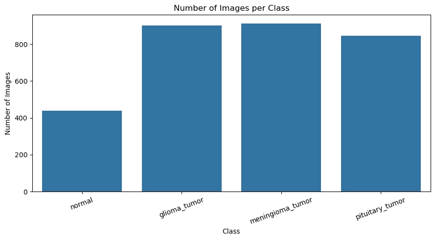
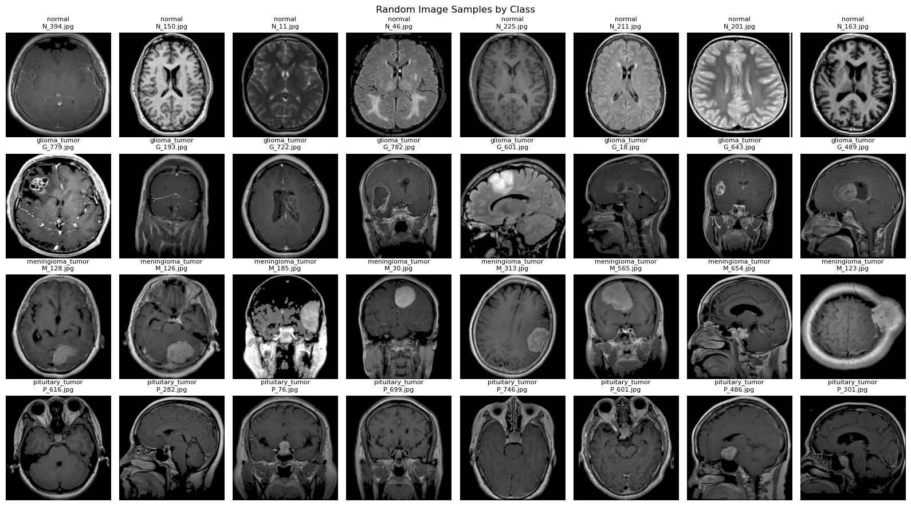
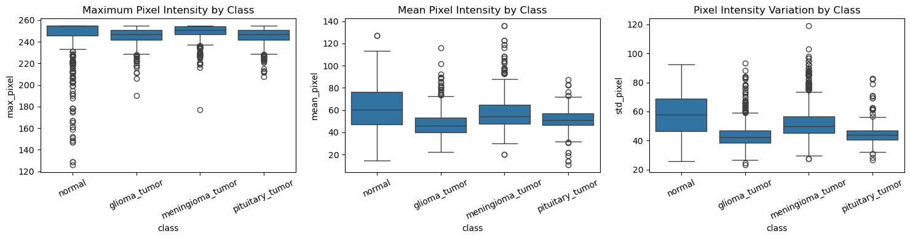
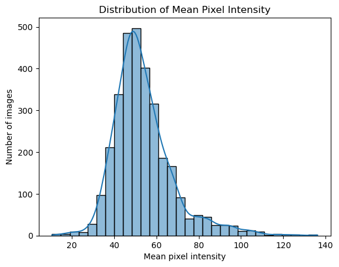
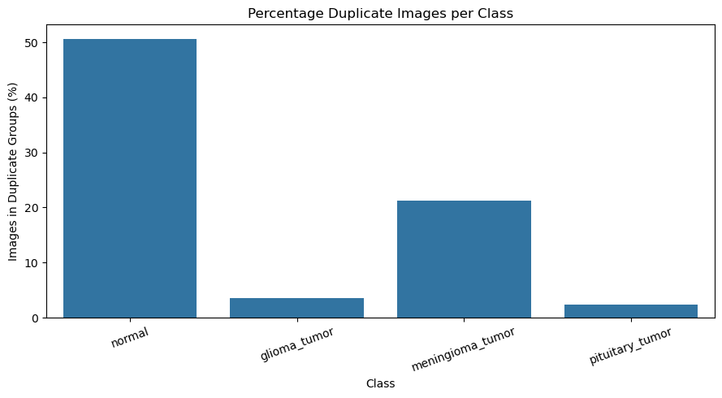

# Data Understanding

## Document Metadata

- **Document Status:** In Review
- **Datum:** 27 oktober 2026
- **Auteur(s):** Jochem Janssen | Rick Voermans
- **Project:** Tumor detectie

---

## 1. Tellen van Afbeeldingen & Dataset Inspectie

- **Totaal aantal gevonden afbeeldingen:** 3.096 afbeeldingen.
- **Aantal afbeeldingen per klasse:**
  - `normal`: 438
  - `glioma_tumor`: 901
  - `meningioma_tumor`: 913
  - `pituitary_tumor`: 844
- **Bestandsformaten:** JPG (3.096 bestanden in totaal).
- **Mappenstructuur:** De mappenstructuur komt overeen met de verwachte klassen, hoewel er bij grondige inspectie een aanwezigheid van zowel MRI- als CT-scans is aangetroffen.

---

## 2. Visualisatie van de Klasse-verdeling

- **Representatie:** Alle vier de categorieën bevatten voldoende data om een deep learning-model mee te kunnen trainen.
- **Verhoudingen & Verschillen:**
  - De klasse `normal` bevat aanzienlijk minder unieke inhoud/afbeeldingen en een hoog aandeel identieke beelden.
  - De tumorklassen bevatten ongeveer evenveel bruikbare voorbeelden, waarbij `pituitary_tumor` het laagste aantal heeft binnen de tumorgroepen.
- **Klasse-weging (Class weights):** Het is raadzaam om in een latere fase gewichten toe te kennen of compenserende technieken te gebruiken, aangezien de `normal` klasse inhoudelijk minder representatieve data bevat.

---

## 3. Voorbeeld-afbeeldingen Per Klasse

Uit een steekproef en visuele inspectie van de afbeeldingen over de vier klassen komen de volgende observaties naar voren:

- **Anatomische verschijning:** Consistente hersenstructuren zijn zichtbaar over de verschillende scans heen.
- **Tumorzichtbaarheid:** Duidelijke afwijkingen (zoals massa's of weefselvervorming) zijn zichtbaar in diverse voorbeelden van de tumorklassen, terwijl gezonde scans een normale structuur tonen.
- **Oriëntatie:** De afbeeldingen tonen verschillende kijkhoeken, hoofdkantelingen en anatomische vlakken.
- **Contrast en helderheid:** De scan-intensiteit en achtergrondwaarden variëren merkbaar door de dataset heen.
- **Beeldkwaliteit:** Er zijn kleine verschillen in scherpte, uitsnede en ruisniveau.
- **Potentiële afkortingen:** Specifieke plakprofielen en specifieke locaties van afwijkingen per klasse creëren een risico voor het trainen van het model.

---

## 4. Afbeeldingsdimensies, Modus en Kwaliteit

- **Dimensies:** Alle afbeeldingen hebben exact hetzelfde formaat van **256x256 pixels**.
- **Modus:** Greyscale
- **Pixelwaarden:** Verschillen in de brightness of intensiteit duiden niet per definitie op de aanwezigheid van een tumor, maar kunnen deels verklaard worden door de mix van verschillende scan-modus (MRI vs. CT).
- **Algemene kwaliteit:** De afbeeldingen leveren over het geheel een consistente kwaliteit en een uniform formaat.

---

## 5. Technische Kenmerken Vergelijken Tussen Klassen

Indien één klasse merkbaar afwijkende pixelstatistieken vertoont, dient dit nader te worden onderzocht op de steekproeven en herkomst. Dit kan een legitieme klinische eigenschap zijn, een verschil in scan-acquisitie (zoals de aanwezigheid van CT-scans versus MRI-scans). Deze verschillen mogen niet automatisch worden verwijderd of weggenummerd voordat de oorzaak begrepen is.

---

## 6. Duplicaten en Data Leakage (Investigate Duplicate Images & Data Leakage)

Dubbele afbeeldingen zijn gedetecteerd op basis van de image hash (MD5/SHA). Duplicaten komen in verhouding voornamelijk voor binnen de `normal` klasse.

### Duplicaten per Klasse (Exact Hashes)

| Klasse                 | Totaal Afbeeldingen | Dubbele Afbeeldingen | Unieke Afbeeldingen | Duplicaat Percentage (%) |
| :--------------------- | :------------------ | :------------------- | :------------------ | :----------------------- |
| **`normal`**           | 438                 | 222                  | 216                 | **50,68%**               |
| **`glioma_tumor`**     | 901                 | 32                   | 869                 | **3,55%**                |
| **`meningioma_tumor`** | 913                 | 194                  | 719                 | **21,25%**               |
| **`pituitary_tumor`**  | 844                 | 20                   | 824                 | **2,37%**                |

---

### Bronnen

- **Bron 1:** Geef informatiebronnen op
